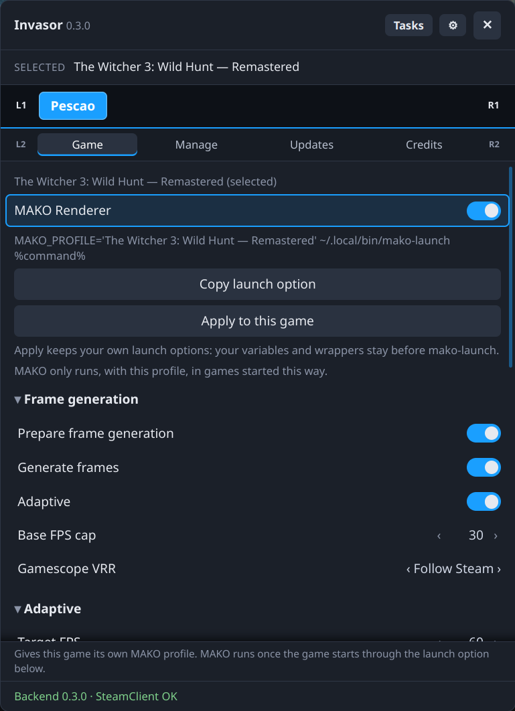
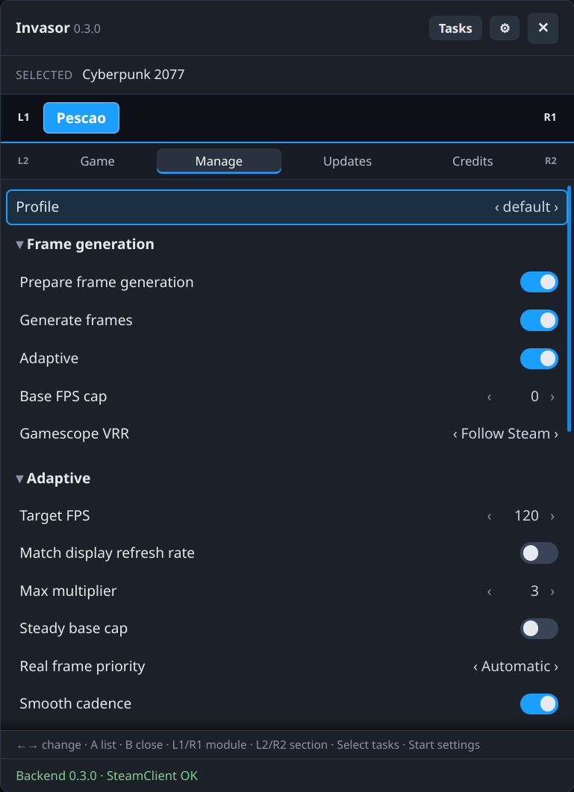
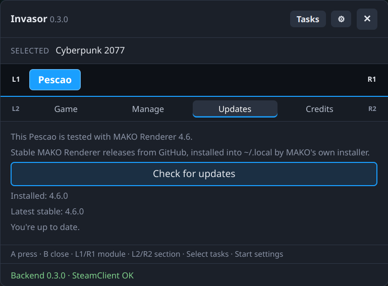

# Pescao

A module for [Invasor](../invasor) that sets up **MAKO Renderer** (frame generation and scaling) per game, from Steam's gamepad UI.

- **Game:** one switch for the game you're on. When it's on, the game gets its own MAKO profile, named after it, and right below the switch its launch option, as mako-ui builds it: `MAKO_PROFILE='<profile>' ~/.local/bin/mako-launch %command%`. *Copy* puts it on the clipboard; *Apply to this game* (when Steam allows it) puts it in the game's launch options for you, keeping your own variables and wrappers before mako-launch, and leaves a line that already has it as it is. Turning the switch off offers to take `MAKO_PROFILE` and mako-launch out of the game's launch options again (nothing is left if only `%command%` remains). MAKO only runs in games started that way, and `MAKO_PROFILE` is what picks the profile: MAKO 4 matches `active_in` against executables and process names, not Steam ids. The game's id is still kept in `active_in`, so Pescao knows which game uses which profile. All the profile's options follow: frame generation, scaling, performance and compatibility. In Quick Access the tab only appears while the running game has a MAKO profile; to give a game its first one, use the library's panel.

  **Shaders are left out for now:** MAKO's bundled vkBasalt effects aren't set up by Pescao. Use mako-ui for them, and add the variables it shows (`ENABLE_VKBASALT=1 VKBASALT_CONFIG_FILE=…`) to the game's launch option.
- **Manage:** every profile (edit, create, duplicate, rename, delete), MAKO's global options and mako-launch's own options for all games (Disable Steam overlay, HDR, Zink, Force ALSA audio).

  **One setting per profile:** mako-ui can give a profile separate battery and AC settings; Pescao edits a single set of options, used on both. For a profile with separate ones (which MAKO uses instead), Pescao says so and offers to remove them.
- **Updates:** checks GitHub for the latest stable MAKO Renderer (`render-vX.Y.Z` releases) and installs it with MAKO's own installer, which checks every file, installs in one transaction and keeps your profiles. The download is checked against the sha256 GitHub publishes for it (Invasor would ask you first if a release had none), and the progress shows as a task. The installed version is read from MAKO's own library. A Renderer managed by MAKO Decky, or installed outside `~/.local`, is never touched.

Settings are kept only in MAKO's own files, written the way mako-ui 4.6 writes them, so both tools can be used on the same profiles (one at a time):

- `~/.config/mako-render/conf.toml`: profiles and global options. Pescao keeps every key, keeps a backup (`conf.toml.invasor-backup`) the first time it changes it, and has MAKO check every change (`mako-cli validate`) before it replaces the file, when mako-cli is available. Options that set others behave as in mako-ui (e.g. Ultra performance).
- `launcher.conf`: mako-launch's Steam overlay, HDR, Zink and ALSA options.

mako-ui's other files (shaders, MAKO Decky's settings and metadata) aren't touched. After renaming a profile, copy or apply its launch option again for the games that use it.

## Screenshots

<p align="center">
  
  
  
</p>

## Requirements
- Invasor 0.3.0 or newer (`min_core`): updates are downloaded with `ctx.http` and unpacked with `ctx.archive`, launch options are read and set with `ctx.steam`, and Copy uses `ctx.copy`.
- [MAKO Renderer](https://github.com/eugeniosegala/MAKO) 4.x installed standalone (tested with 4.6.x), and your own copy of Lossless Scaling for frame generation and LS1 scaling. Newer 4.x releases work, though options they add may not show in Pescao; a new major version needs a newer Pescao.

## Build, test and install
With the core checked out next to this repository (`../invasor`):

```sh
python3 ../invasor/tools/pack_module.py pescao       # build, check, tests -> pescao-<version>.zip
python3 ../invasor/tools/install_module.py pescao    # or install that zip from ⚙ Settings › Install module
```

Tests on their own: `INVASOR_CORE=../invasor python3 -m unittest discover -s pescao`.

## Credits
MAKO is by Eugenio Segala and its contributors (GPL-3.0), and comes from lsfg-vk by PancakeTAS and its contributors; Lossless Scaling and its frame generation belong to their developers. Pescao is not affiliated with any of them. Please don't report problems with this module to them.

## License
[GNU General Public License v3.0 or later](LICENSE) (GPL-3.0-or-later).
